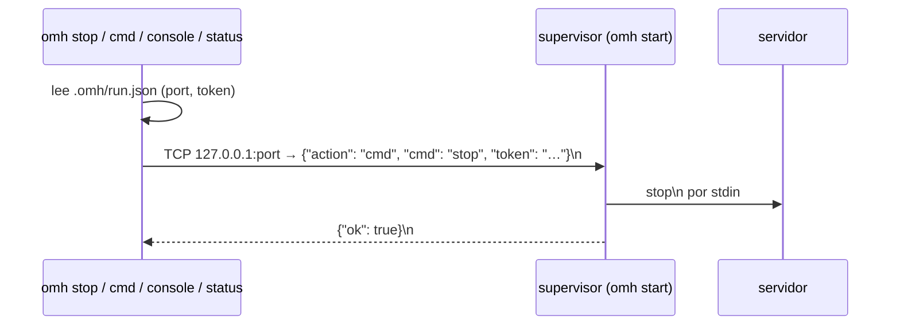

# Canal de control

Cómo se comunican los demás comandos de omh con el [[Supervisor (Runner)]].

## Protocolo (una línea JSON por petición y por respuesta)
- Escucha en `127.0.0.1` con un puerto que elige el sistema, apuntado en [[run.json]].
- Petición: `{"action": "ping"|"cmd", ["cmd": "<texto>",] "token": "<token>"}` + `\n`. El servidor lee hasta `\n` (máximo 64 KB) con un timeout de 5 s.
- El token se compara en tiempo constante (`secrets.compare_digest`).
- Respuestas:
  - token incorrecto: `{"ok": false, "error": "token"}`;
  - `ping`: `{"ok": true, "pid": <pid>, "ready": <bool>}`;
  - `cmd`: `{"ok": <se pudo escribir>}`;
  - otra acción: `{"ok": false}`;
  - JSON inválido o error de E/S: cierra sin responder.
- Cada conexión se atiende en su propio hilo.

## Cliente
- `control_request`: lee `run.json` (si no hay, no está en marcha), añade el token, conecta (timeout de 5 s, 2 s para el ping), envía, lee hasta `\n` y decodifica (cuerpo vacío = `null`). Cualquier error → `None`.
- `is_running(carpeta)` = el ping responde con `ok`. Es **la** forma de saber si un servidor está en marcha (no basta con que exista `run.json`).
- `send_command(carpeta, texto)` = `cmd` con `ok`.

## Compatibilidad
El protocolo tiene que ser idéntico en Rust, para que un `omh` nuevo pueda parar o mandar comandos a un servidor lanzado por el `omh.py` antiguo, y al revés → [[Compatibilidad de formatos]]. Seguridad del token → [[Seguridad]].
