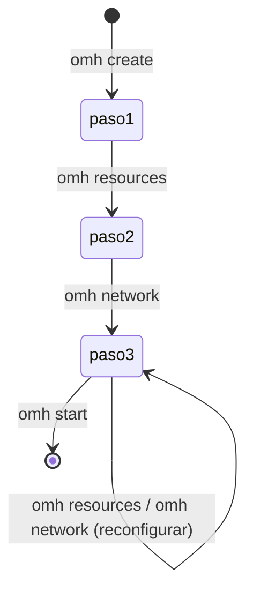

# Flujo de 3 pasos

El campo `step` de [[omh.json]] dice hasta qué paso está configurado el servidor.

| `step` | Lo deja | Cómo |
|---|---|---|
| 0 | — | Solo existe en memoria durante [[omh create]]; nunca se guarda |
| 1 | [[omh create]] | `step = 1` (con `--force` se reinicia a 1) |
| 2 | [[omh resources]] | `step = max(step, 2)` (si ya era 3, sigue en 3) |
| 3 | [[omh network]] | `step = 3` |

## Qué paso exige cada comando
Si falta, el mensaje es `Falta el paso N. Ejecuta primero: omh create|omh resources|omh network`.
- Paso 1: `resources`, `whitelist`, `admin`, `plugin`.
- Paso 2: `network`.
- Paso 3: `start` y `restart` (en las comprobaciones previas).
- Ninguno, pero sí [[omh.json]]: `status`, `stop`, `console`, `logs`, `cmd`, `eula`, `tunnel`.
