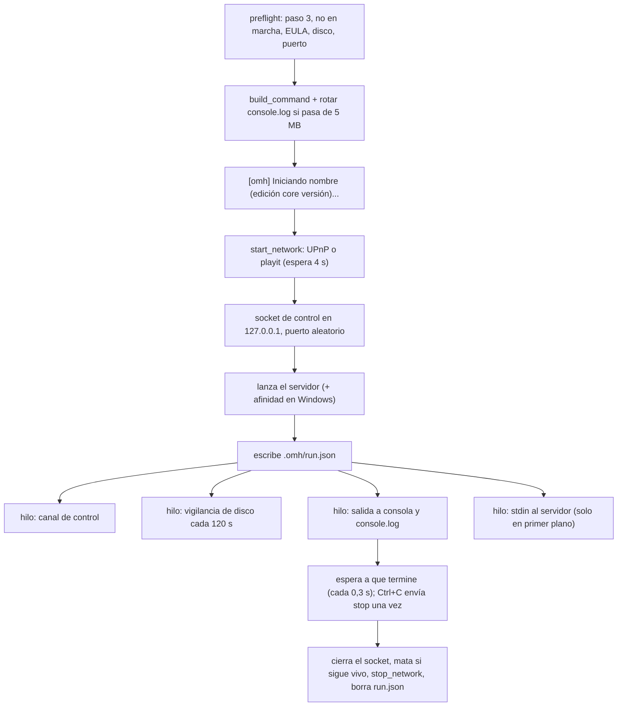

# Supervisor (Runner)

El proceso `omh start` (en primer plano, o `omh start --daemon` en segundo plano) que lanza el servidor y se queda vigilándolo.

## Piezas
- **send(comando)**: quita `\r`, cambia `\n` por espacio y recorta espacios. Si queda vacío o el servidor ya no está, devuelve falso. Escribe `comando\n` en UTF-8 en el stdin del servidor (con un candado).
- **say(msg)**: `  [omh] msg` en pantalla y `[omh] msg` en `console.log` → [[Mensajes y titulo]].
- **Salida del servidor**: lee líneas (separadas por `\n`), las decodifica en UTF-8 sustituyendo bytes inválidos y quita `\r\n`. Las imprime si no es daemon y las escribe en `console.log`.
  - Servidor listo: la primera línea que encaja con `Done \(|Server started\.|Done!` → `Servidor listo. Direcciones:` y las [[Direcciones del servidor]].
  - Bedrock: `Player connected: (.+?), xuid` → si el jugador está en `network.admins` y aún no se le dio en esta sesión, envía `op "<nombre>"` → [[Core vanilla (Bedrock)]].
- **Canal de control** → [[Canal de control]].
- **Disco** → [[Limite de almacenamiento]].
- **Red pública**:
  - UPnP: abre el puerto (y `port_v6`) con la descripción `open-mc-host <nombre>` → `UPnP: puerto P/PROTO abierto. IP publica: X`; si falla, `UPnP no disponible: el puerto no se abrio en el router.` o `UPnP: el router rechazo abrir el puerto (<error>).` → [[UPnP]].
  - playit: lanza el agente con la salida en `.omh/playit.log` (stdin nulo; en Windows `CREATE_NO_WINDOW`) → `Tunel playit.gg iniciado (registro en .omh/playit.log).`; espera 4 s y, si aparece un enlace de vinculación, `playit.gg aun no esta vinculado. Abre <url> o ejecuta: omh tunnel` → [[Tunel playit.gg]].
  - Al parar: borra las reglas UPnP y termina el agente (`terminate()`: SIGTERM o TerminateProcess) esperando hasta 10 s.
- **Fin**: `[omh] Servidor detenido (codigo N).` (en Linux, N es negativo si lo mató una señal). Espera al hilo de salida hasta 5 s.

## Primer plano frente a segundo plano
| | Primer plano | Daemon (`--detach`) |
|---|---|---|
| Consola del servidor en pantalla | sí | no (solo `console.log`) |
| Escribir comandos | stdin | [[omh console]] / [[omh cmd]] |
| EULA sin aceptar | pregunta | error |
| Ctrl+C | envía `stop` una vez | — |
| Salida de omh | terminal | `.omh/wrapper.log` |
