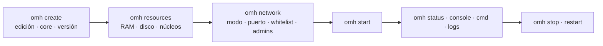

# OPEN-MC-HOST

`omh` es una herramienta de terminal que convierte un PC con **Windows o Linux** en un servidor de **Minecraft Java o Bedrock**. Descarga el servidor, Java y el túnel desde las fuentes oficiales y lo configura en tres pasos, preguntando lo que falte.

| | |
|---|---|
| Repositorio | `IzanLey/OPEN-MINECRAFT-HOST` (rama `main`) |
| Versión publicada | **0.0.1**: un solo archivo `omh.py` (~2.400 líneas, solo biblioteca estándar de Python 3.8+) |
| Siguiente versión | **0.1.0**: reescritura en Rust, un binario `omh` sin dependencias → [[Objetivo de la migracion]] |
| Licencia | MIT (cada servidor descargado tiene la suya) |

## Mapas
- [[Mapa de comandos]]: los 19 subcomandos, sus opciones y sus preguntas.
- [[Mapa de archivos]]: todo lo que lee y escribe ([[omh.json]], [[Carpeta .omh]], [[Carpeta global]]…).
- [[Mapa de APIs externas]]: cada servicio y endpoint al que llama.
- [[Mapa de cores]]: los 9 servidores que sabe instalar.
- [[Mapa de conceptos]]: piezas internas (descargas, red, supervisor, seguridad…).
- [[Mapa de la migracion a Rust]]: módulos, crates, fases, bugs y decisiones.

## El recorrido de un servidor

## Ideas que atraviesan toda la herramienta
- Un servidor es una carpeta con su [[omh.json]]. La lista de servidores y el activo están en [[state.json]] → [[Servidor activo]].
- La configuración va por pasos y cada comando comprueba el anterior → [[Flujo de 3 pasos]].
- No se instala nada en el sistema: Java ([[Java Temurin]]), el agente del [[Tunel playit.gg]] y los servidores viven en carpetas del usuario.
- Las descargas se verifican con SHA-1/SHA-256 cuando la fuente publica el hash → [[Descargas verificadas]]. Los comprimidos se extraen sin salir de su carpeta → [[Extraccion segura]].
- `omh start` deja un proceso supervisor que reenvía la consola, vigila el disco y atiende órdenes por un [[Canal de control]] local con token → [[Supervisor (Runner)]].
- Lo que ve el usuario está en español **sin tildes** (pensado para consolas antiguas) → [[Mensajes y titulo]].
- omh nunca toca el firewall ni pide contraseñas → [[Seguridad]].
